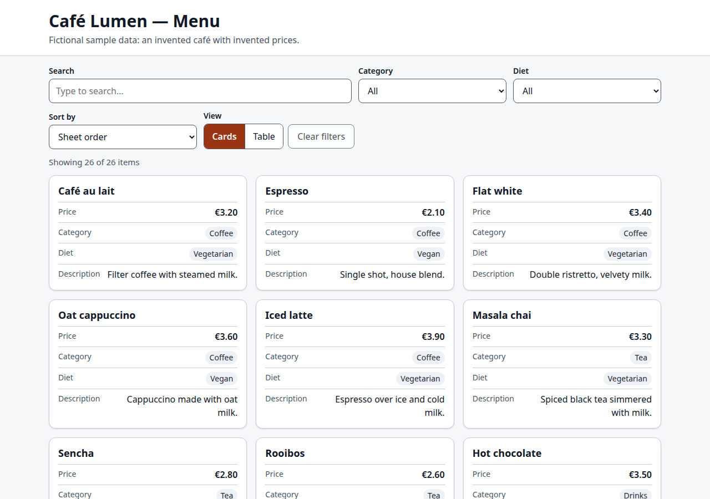
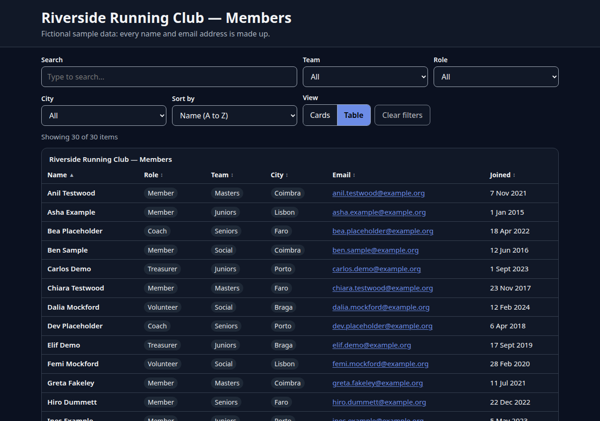
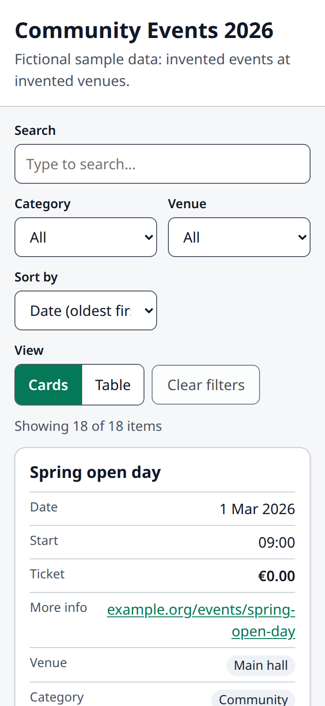

# sheet-showcase

**Turn an Excel or CSV sheet into a clean, searchable, mobile-friendly web page. You don't need a CMS, a database or a build step.**

Small businesses, clubs and NGOs often keep their menus, price lists, member directories and event schedules in Excel. sheet-showcase reads that sheet and builds a page from it with:

- a card view and a table view;
- instant search that ignores accents and case;
- filters and sorting;
- shareable links that keep the current search, filters and sort;
- dark mode and a print stylesheet.

You can run it in two ways:

- **Live mode:** drop `.xlsx`/`.csv` files into `data/` on any cheap PHP host. Each file becomes `index.php?sheet=<name>`, and editing the sheet updates the page.
- **Static export:** `php bin/showcase export menu.xlsx` writes **one self-contained HTML file**. You can upload it anywhere: GitHub Pages, Netlify, an S3 bucket or WordPress media. The page makes zero network requests.

| Light, card view | Dark, table view | Mobile |
|---|---|---|
|  |  |  |

> **All sample data is fictional.** The café, its prices, the running club members and their email addresses (`@example.org`), and the events and venues in `data/` were all invented for this demo. Any resemblance to real people or businesses is coincidental.

---

## Quick start (60 seconds)

Requirements: PHP 8.1 or newer with the `zip`, `xml` and `mbstring` extensions. Most shared hosts have these enabled by default.

```bash
git clone <this repo> sheet-showcase && cd sheet-showcase

# Live mode: open http://localhost:8000/?sheet=cafe-menu
php -S localhost:8000 -t public

# Static export: writes one HTML file and needs nothing else
php bin/showcase export data/cafe-menu.xlsx -o dist/cafe-menu.html

# Show the inferred columns and types for any sheet
php bin/showcase inspect data/club-members.csv
```

To use your own data, save your sheet as `data/price-list.xlsx` (or `.csv`) and open `/?sheet=price-list`. You don't need a config file: column types, filters and layout are inferred from the data. Add a `showcase.json` only if you want to change something.

The three samples are:

| URL | File | Shows |
|---|---|---|
| `/?sheet=cafe-menu` | `data/cafe-menu.xlsx` | Cards, currency, two filters, a custom accent colour |
| `/?sheet=club-members` | `data/club-members.csv` (`;`-separated) | Table layout, emails, dates, three filters, default sort |
| `/?sheet=event-schedule` | `data/event-schedule.csv` | Dates sorted by default, links, renamed columns |

---

## Input formats

| Format | Supported |
|---|---|
| `.csv` | The delimiter is detected automatically: `,` `;` tab or `\|`. Encodings: UTF-8 with or without a BOM, UTF-16 with a BOM, and a fallback that converts **Windows-1252** (classic Excel on Windows, e.g. `é`, `€`). Quoted fields may contain delimiters, `""` and line breaks. Short ("ragged") rows are padded with empty cells. |
| `.xlsx` | **First sheet only.** Supports shared strings, inline strings, numbers, booleans (`TRUE`/`FALSE`), and dates stored as serial numbers with a date format, which become ISO `YYYY-MM-DD` (both the 1900 and 1904 date systems). For formulas, the value Excel cached in the file is shown. Formulas are **never evaluated**. |

The first row is the header row. Empty headers become `Column N`, and duplicate headers get a ` (2)` suffix.

### Type inference

Each column's type is guessed from its first 200 non-empty values:

| Type | Detected when every sampled value… | Rendered as |
|---|---|---|
| `email` | is a valid email address | `mailto:` link |
| `url` | is an absolute `http(s)://` URL | link showing a short `host/path` |
| `image` | is an `http(s)` URL ending in `.jpg/.png/.gif/.webp/.avif/.svg` | image (lazy-loaded) |
| `date` | is an ISO date `YYYY-MM-DD` (with an optional time). Excel dates are converted automatically. | localised date |
| `number` | is a number (`1234.5`, `1,234.5`, `1.234,5`, `3,50`) | localised number, right-aligned |
| `currency` | is a number with a currency sign (`€3.50`, `₹120`, `9.99 USD`), **or** a number column whose header contains *price, cost, fee, amount, total, rate* | localised money |
| `tag` | is text with **12 or fewer distinct values**, each appearing twice or more on average and ≤ 40 characters long | chip. Tag columns become filters by default (max 3). |
| `text` | anything else | plain text |

---

## Configuration: `showcase.json`

This file is optional and lives next to the data file. The lookup order for `data/menu.xlsx` is:

1. `data/menu.showcase.json`
2. `data/showcase.json`. Top-level keys are shared defaults. A `"sheets": {"menu": {…}}` map overrides them per sheet. The samples use this layout; see [`data/showcase.json`](data/showcase.json).

| Key | Type / values | Default | Description |
|---|---|---|---|
| `title` | string | file name, e.g. `price-list` → "Price list" | Page heading and `<title>`. |
| `subtitle` | string | none | Line under the title. |
| `columns` | array of `"Header"` or `{ "name", "label", "type", "hidden" }` | all columns in sheet order | Listed columns come first, in the order given. Any unlisted columns follow. `name` matches the sheet header (case-insensitive). `label` renames a column. `type` overrides inference. `hidden: true` removes the column from the page **and** from the embedded data. |
| `type` (per column) | `text` `number` `currency` `date` `url` `email` `image` `tag` | inferred | See the type inference table above. |
| `filters` | array of column names | up to 3 `tag` columns | Each gets a dropdown filled with that column's distinct values. Use `[]` for no filters. |
| `sort_default` | `"Column"`, `"-Column"` (descending) or `{ "column", "direction": "asc"\|"desc" }` | sheet order | Initial sort. Empty values always sort last. |
| `theme` | `light` `dark` `auto` | `auto` | `auto` follows the visitor's `prefers-color-scheme`. |
| `accent_color` | hex, `#rgb` or `#rrggbb` | `#1d4ed8` | Used for buttons and links. It is **automatically adjusted** to reach at least 4.5:1 contrast in both the light and dark themes. |
| `layout` | `cards` `table` | `cards`, or `table` if there are more than 6 columns | Initial view. Visitors can switch views. |
| `currency` | ISO 4217 code, e.g. `EUR` | from symbols in the data, else `USD` | For `currency` columns. |
| `locale` | BCP 47 tag, e.g. `en-GB`, `de`, `hi-IN` | `en` | Number and date formatting, and the page `lang`. |

Invalid values stop the build with a clear message, for example `"theme" must be one of: light, dark, auto.` To check a config, run `php bin/showcase inspect <file>`.

Example:

```json
{
  "title": "Café Lumen — Menu",
  "subtitle": "Prices include VAT",
  "currency": "EUR",
  "locale": "en-GB",
  "layout": "cards",
  "accent_color": "#9a3412",
  "columns": [
    "Item",
    { "name": "Price", "type": "currency" },
    { "name": "Internal notes", "hidden": true }
  ],
  "filters": ["Category", "Diet"],
  "sort_default": "Item"
}
```

---

## Using the page

- **Search** runs after a 150 ms debounce. It ignores accents and case (`cafe` finds `Café`), and every word must match.
- **Filters** are dropdowns. **Sort** works on any column from the "Sort by" menu, or by clicking a table header. Sorting understands numbers, dates and text (natural order: `Item 9` comes before `Item 10`).
- **Shareable links:** the search, filters, sort and view are stored in the URL hash, e.g. `#q=cafe&category=Coffee&sort=price&dir=desc`. Reloading or sharing the link restores the same view.
- **Load more** shows 50 more items at a time. The result count is announced to screen readers through `aria-live`.
- **Print** (Ctrl/Cmd+P) produces a plain table of every matching row, without controls.
- **Without JavaScript**, the first 50 items still render as plain HTML.

---

## Deploy

### Shared PHP hosting (live mode)

The safest layout is to make `public/` the web root and keep everything else above it:

```
/home/you/sheet-showcase/        <- upload the whole project here
├── data/  src/  templates/  bin/
└── public/                      <- point the domain / document root here
```

If your host can't change the document root:

- upload the contents of `public/` into `public_html/`;
- put `src/`, `templates/` and `data/` one level above it;
- set `$appRoot` at the top of `index.php` to the folder that holds `src/`, `templates/` and `data/`.

Then:

- `data/.htaccess` (included) blocks direct downloads of the raw files on Apache. On nginx, add `location ^~ /data/ { deny all; }` if `data/` is ever inside the web root.
- To publish changes, replace the file in `data/` (via FTP or the file manager). The next page view picks it up. No cache needs clearing.
- Optionally, set `SHEET_SHOWCASE_DATA=/path/to/data` in the environment to keep the data elsewhere.

### Static hosting (export)

```bash
php bin/showcase export data/event-schedule.csv -o dist/events.html
```

`dist/events.html` is a single file with the CSS, JavaScript and data inlined. It works from:

- GitHub Pages (commit it as `index.html`);
- Netlify drop;
- S3 or Cloudflare R2;
- a WordPress media upload (link to the file);
- an email attachment;
- a USB stick opened with `file://`.

Re-export whenever the sheet changes.

---

## Security notes

- **Output escaping:** every cell, label and title is escaped with `htmlspecialchars` on the server. On the client, values are written with `textContent` and attribute setters, **never `innerHTML`**.
- **URLs:** `url` and `image` cells become links or images only if they are absolute `http://` or `https://` URLs. `javascript:`, `data:`, relative and malformed URLs are shown as plain text. Links use `rel="noopener noreferrer nofollow"`.
- **Embedded JSON:** it is encoded with `JSON_HEX_TAG | JSON_HEX_AMP | JSON_HEX_APOS | JSON_HEX_QUOT`, so a cell containing `</script>` or `<!--` can't break out of the `<script type="application/json">` block.
- **Content-Security-Policy:**
  - `default-src 'none'` everywhere;
  - the export allows only its own inline script and styles, by SHA-256 hash;
  - live mode allows `'self'` scripts, plus `frame-ancestors 'none'`, `nosniff` and `no-referrer`.
- **Formulas** are never evaluated. A cell such as `=HYPERLINK(…)` is shown as text.
- **Path traversal:** `?sheet=` accepts only `[a-z0-9_-]{1,64}`. Anything else, such as `../../etc/passwd`, `..%2Fsecret`, uppercase names, arrays or null bytes, returns **HTTP 404 with a generic message**. As a second check, the resolved real path must lie inside `data/`.
- **XLSX parsing** uses streaming `XMLReader` without entity expansion, so it is safe against XXE. Each part of the zip is size-capped to guard against zip bombs.
- **No uploads, no writes:** the app only reads files the owner puts in `data/`.
- **Hidden columns** are removed before rendering, so their values never reach the browser.

Two limits to be aware of:

- **Image columns** load images from the hosts in your sheet. A page with images therefore makes those image requests; the samples contain none.
- **Everything in a visible column is public.** The embedded data is readable by anyone who opens the page.

---

## Measurements

### Performance with 5,000 rows (acceptance criterion 9)

The test generated a 5,000-row × 6-column sheet, exported it, and loaded it in headless Chromium from `file://`. There were 5 runs, with 3 searches per run. Machine: Intel Core i5-1035G1 laptop (4 cores / 8 threads), Playwright Chromium, measured 15 Oct 2026. To reproduce, run `npm run perf`.

| Metric | Target | Measured |
|---|---|---|
| Export file size | ≤ 2 MB | **0.75 MB** (782 KB) |
| First render (navigation start → list painted) | < 1 s | **77 ms** median, 78 ms max |
| Search update (filter + sort + render 50 items; excludes the 150 ms debounce) | < 100 ms | **7.1 ms** median, 9.0 ms max |

The page records `showcase:render` User Timing entries, so you can check these numbers in DevTools → Performance on your own data.

### Lighthouse (acceptance criterion 10)

Setup:

- Lighthouse 13.5.0 with default **mobile** emulation (throttled);
- run on `dist/cafe-menu.html` served by `php -S` (localhost);
- headless Chromium 156;
- measured 15 Oct 2026.

| Category | Target | Score |
|---|---|---|
| Performance | ≥ 90 | **100** |
| Accessibility | ≥ 95 | **100** |
| Best Practices | ≥ 95 | **100** |
| SEO (not required) | n/a | 91. The only miss is `robots.txt`, which the bare dev server doesn't serve. |

There is also an automated axe-core check (`tests/e2e/a11y.e2e.mjs`). It finds **0 violations** for WCAG 2.1 A/AA and best practices. It runs on all three samples, in light **and** dark themes, in both card and table views.

### Responsive layout (acceptance criterion 11)

A browser test checks that the page has no horizontal scroll at 360, 768 and 1280 px, for both samples and both views. Wide tables scroll inside their own focusable region. The screenshots are in `docs/screenshots/`: `cards-light.png`, `table-dark.png`, `mobile.png` and `mobile-dark-search.png`.

---

## Development and tests

```bash
composer install          # dev only: PHPUnit
composer test             # PHPUnit: readers, inference, renderer/XSS, live server, CLI
node --test               # JS core: search/filter/sort/hash (node:test, no deps)

npm ci                    # dev only: Playwright + axe-core
npx playwright install chromium
npm run e2e               # browser tests: offline export, XSS dialogs, hash restore, layout, axe
npm run perf              # 5,000-row measurement
npm run screenshots       # regenerate docs/screenshots

php tools/build-samples.php   # regenerate data/ samples and test fixtures (deterministic)
```

| Acceptance criterion | Covered by |
|---|---|
| 1. Live cafe menu as cards, no warnings | `tests/php/LiveModeTest.php`, `tests/e2e/browser.e2e.mjs` |
| 2. Single-file export, works offline, zero requests | `RendererTest::testExportIsOneSelfContainedFile`, `CliTest`, e2e "works offline" |
| 3. CSV delimiters, BOM, Windows-1252, quoting, ragged rows | `tests/php/CsvReaderTest.php` and the fixtures in `tests/php/fixtures/` |
| 4. XLSX equals CSV export | `tests/php/XlsxReaderTest.php` (`roundtrip.xlsx` vs `roundtrip.csv`) |
| 5. Type inference | `tests/php/TypeInfererTest.php` (`types.csv` and the samples) |
| 6. XSS inert in live and export | `RendererTest` (DOM-parsed server HTML), `LiveModeTest`, e2e "no dialog fires" |
| 7. Path traversal returns 404 | `LiveModeTest::testPathTraversalAndBadNamesAre404`, `ConfigTest::testLibraryWhitelist` |
| 8. Search + filter + sort + hash | `tests/js/core.test.js`, e2e "state persists in the hash" |
| 9. 5,000 rows | `npm run perf` (results above), plus a `node --test` timing guard |
| 10. Lighthouse | Results above; axe-core e2e |
| 11. No horizontal scroll, screenshots | e2e "responsive layout", `docs/screenshots/` |
| 12. CI on PHP 8.1 and 8.3 | `.github/workflows/ci.yml` |

### Project layout

```
bin/showcase            CLI: export, inspect
src/                    CsvReader, XlsxReader, TypeInferer, Config, Showcase, Renderer, Exporter, Library, Formatter, Color
public/index.php        live mode
public/assets/          app.css, app.js (DOM), core.js (pure search/filter/sort, unit-tested in Node)
templates/page.php      page markup
data/                   fictional samples + showcase.json
tests/php  tests/js  tests/e2e
tools/                  sample/fixture generator (dev only)
```

There are no runtime dependencies. Composer (PHPUnit) and npm (Playwright, axe-core) are used for development only.

---

## AI-assistance disclosure

This project was built with AI assistance: Anthropic's Claude helped write the code, tests and documentation. The tests in this repository then verified it, and the Lighthouse and performance numbers above come from actual runs.

## Licence

[MIT](LICENSE) © 2026 Harsha Shinde
